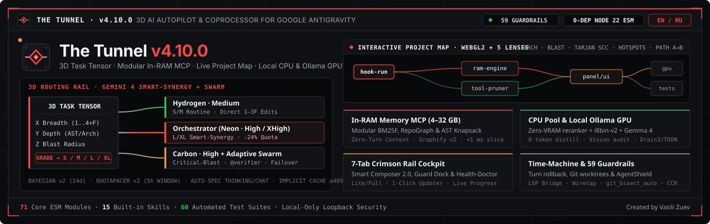
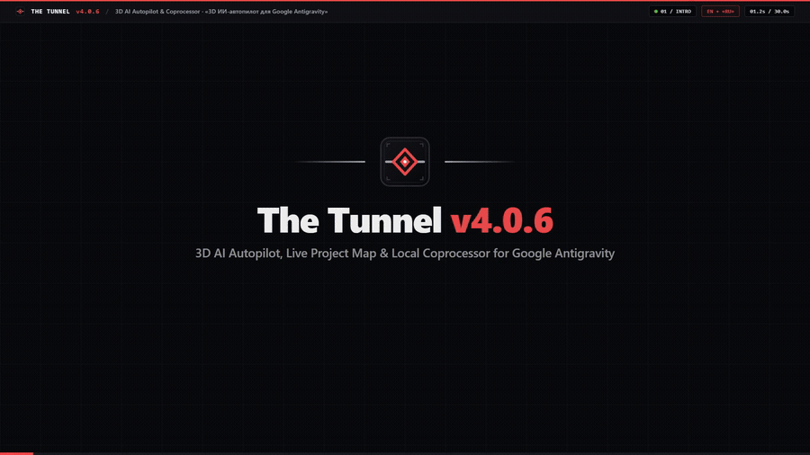
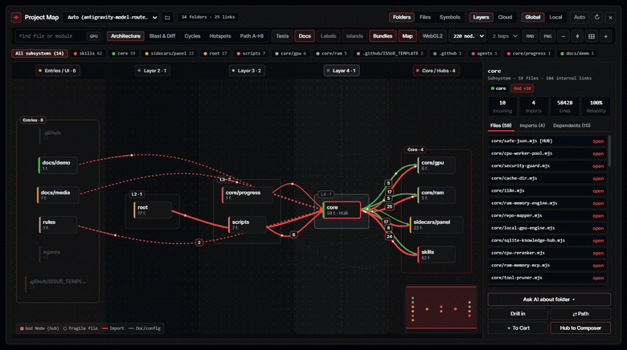
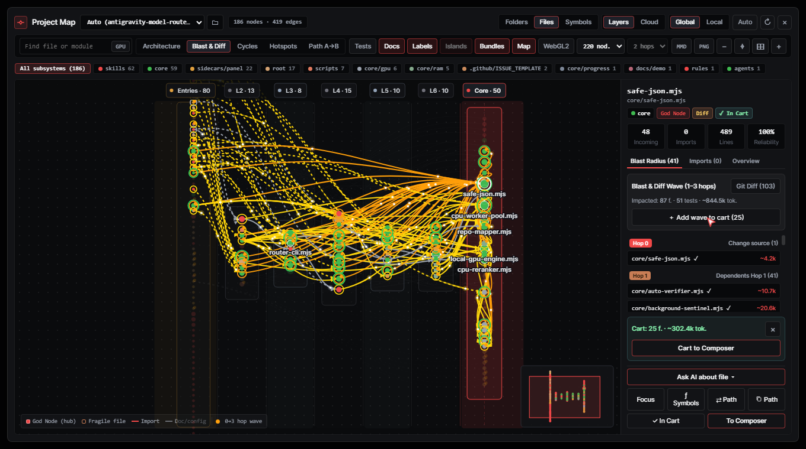
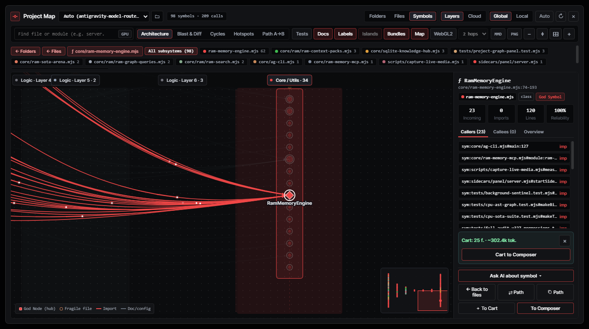
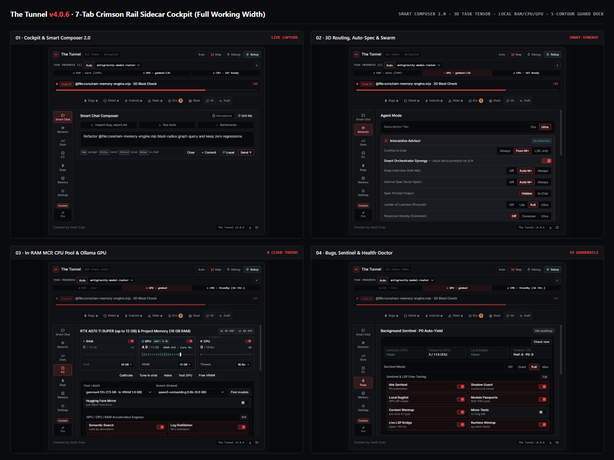
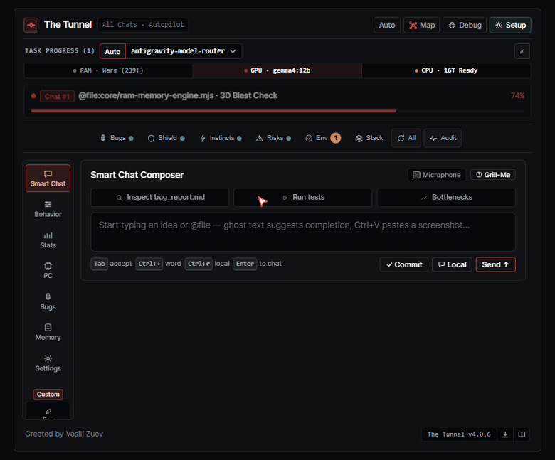

<p align="center">
  
</p>

<p align="center">
  
  
  
  
  
  
</p>

# The Tunnel `v4.0.9` — 3D AI Autopilot & Model Router

> **Zero-dependency (`Node.js >=22` ESM) engineering cockpit for Google Antigravity:** 3D model routing (`Breadth × Depth × Risk`), Interactive Project Map (`WebGL2`), modular In-RAM MCP (`4–32 GB`), multi-core CPU coprocessor, optional local Ollama GPU (`0` cloud tokens), and **59 active guardrails**.

---

## 🎬 30-Second Interactive Demo (`EN` + `«RU»` · Sound & FX)

<p align="center">
  <a href="docs/media/the-tunnel-demo-v4.mp4">
    
  </a>
  <br/>
  <sub>
    <b>Watch full 30s 1080p HD Video with Sound &amp; FX:</b>
    <a href="https://github.com/vaszuevvas-coder/antigravity-model-router/raw/main/docs/media/the-tunnel-demo-v4.mp4">Download / Stream MP4 (The Tunnel v4)</a> ·
    <a href="docs/media/the-tunnel-demo-v4.mp4">Repo MP4</a> ·
    <a href="docs/demo/index.html">Interactive Web Player (Web Audio SFX &amp; Lens Switcher)</a>
  </sub>
</p>

---

## 🗺️ Interactive Project Map (`?view=graph` · Live Engine Capture)

Explore real architecture, transitive impact waves, dependency cycles, and AST symbol call graphs — directly from your workspace in RAM, scaling smoothly to **25,000 nodes** via **Barnes-Hut `O(N log N)` + WebGL2 Instanced Rendering**.

<p align="center">
  
</p>

| Blast &amp; Diff Wave (`1–3 hops`) + Context Cart | AST Symbol Call Graph (`RamMemoryEngine`) |
| :---: | :---: |
|  |  |

- **5 Engineering Lenses:** **Architecture** (hybrid layer columns & cloud hulls), **Blast & Diff** (1–3 hop impact wave + live `git diff`), **Cycles** (`Tarjan SCC` + orphan detector), **Hotspots** (Git churn × coupling), and **Path A→B** (`Shift+click` shortest chain).
- **Rich Hover Tooltips & Smart Context Prompts:** `750/500 ms` hover cards plus 1-click **Context Cart** (`@file:` token budget) that automatically attaches connected modules, folder files, and detected risks when sending to chat or Smart Composer.
- **Zero-Friction Navigation & Export:** Instant **Folders → Files → AST Symbols** drill-down, Edge Bundling, interactive Minimap, local GPU semantic search, and 1-click **Mermaid (`MMD`) / PNG** export.

---

## 🎛️ 7-Tab Crimson Rail Cockpit & Smart Composer 2.0 (`EN / RU`)

<p align="center">
  
</p>

- **7-Tab Modular Cockpit & Lite Mode:** Dedicated tabs (`cockpit / behavior / economy / hardware / bugs / memory / settings`), adaptive UI scaling (`90%–130%`), live `EN ↔ RU` switching, built-in **What's New** changelog modal, and safe 1-click **GitHub Plugin Updater**.
- **Smart Composer 2.0:** Fast `@file:`, `@symbol:`, `@git:diff`, and `@error:last` chips, Ghost Text autocomplete, local Ollama Vision screenshot audit (`/api/composer/vision`), optional voice dictation, and `0-token` pre-commit checks.
- **5-Contour Hybrid Guard Dock & Health-Doctor:** Real-time pulse for **Background Sentinel**, **AgentShield**, **Instincts**, **Fragile Files**, and **Runtime Health-Doctor** (1-click stale lock/worktree cleanup, RAM warm, Ollama recovery) + rotating **NDJSON Debug Logger**.

<details>
<summary><b>▶ View Live Sidecar Panel Walkthrough Animation (Smart Composer, Tabs &amp; EN↔RU Switch)</b></summary>
<p align="center">
  
</p>
</details>

---

## ⚡ 3D Task Tensor & Local Coprocessor Stack

### 3D Routing (`Breadth × Depth × Risk`) + Gemini 4 Smart-Synergy
| Task Grade | Recommended Power | How The Tunnel Optimizes It |
| :--- | :--- | :--- |
| **`S / M` Routine** | `Hydrogen · Medium` | Direct `1–3` file edits, zero planner overhead, `Flash 3.8` for micro-tasks |
| **`L` Multi-File** | `Orchestrator (Neon · High)` | **Smart-Synergy** (`-24%` quota vs standalone heavy models), **Auto-Spec** (`thinking \| chat`), **Grill-Me Frontier** |
| **`XL` / Critical-Blast** | `Carbon · High` + **Adaptive Swarm** | Isolated git worktrees (`workspace: "share"`), auto-attached `@verifier`, **QuotaPacer v2** (`5h` rolling window) & failover |

> Supports **AGY 2.35+ Split-Turn Model-Switch Handoff**, **Bayesian v2** file fragility tracking (`14d` half-life), and **Implicit Cache Warmth** (`>=4096t` static prefix stability).

### Zero-Token Local Acceleration (`RAM + CPU + Optional GPU`)
| Coprocessor | Engine & Modules | What It Delivers |
| :--- | :--- | :--- |
| **In-RAM MCP (`4–32 GB`)** | `core/ram/{search,slicer,graph-queries,context-packs}.mjs` | Sub-millisecond `ram_slice`, `BM25F + Trigram`, `LongCodeZip` AST Knapsack, `RepoGraph` & **Graphify v2** |
| **CPU Worker Pool** | `core/cpu-worker-pool.mjs`, `core/cpu-reranker.mjs`, `core/obs-masker.mjs` | Zero-VRAM `<15 ms` RU↔EN Cross-Reranker, `Drain3` + `Headroom` JSON crusher, `TOON` (`-35%` tokens), `Myers` delta, `Mutation Guard` |
| **Local Ollama GPU** | `core/local-gpu-engine.mjs`, `core/gpu/gpu-vram-runtime.mjs` | `i8bin-v2` Int8 MRL-512 semantic index (`qwen3-embedding`), `gemma4:12b` 0-token log distill, Vision audit, post-edit critic & 1-click Ollama installer |

---

## 🛡️ 59 Guardrails, Time-Machine & 15 Built-in Skills

- **Atomic Turn Time-Machine & Shadow Worktrees:** Turn-bound rollback (`core/shadow-guard.mjs`) and detached git sandboxes (`core/shadow-worktree.mjs`) for safe experimentation.
- **Verification & Deep Diagnostics:** `LSP Bridge` (`core/lsp-bridge.mjs`), `Runtime Wiretap` (`±6`-line crash frames + `git_bisect_auto`), `Completion Gates` (`GATES.md`), `Shortcut Debt Ledger`, and **SQLite 3-Layer Episodic Memory + Headroom CCR**.
- **Security & Privacy First:** Local-only loopback binding (`127.0.0.1`), `AsyncLocalStorage` request isolation, `.agentignore` + secret redaction (`core/security-guard.mjs`), and `AgentShield` MCP/skill audits.

<details>
<summary><b>🧩 All 15 built-in specialized skills (<code>skills/</code>)</b></summary>

`model-router` · `context-fork` · `deep-stress-auditor` · `ui-ux-design-system` · `ast-codemod-refactor` · `program-slicer-ocd` · `delta-bug-minimizer` · `skill-architect` · `github-publish-guard` · `cli-anything-harness` · `playwright-cli` · `game-systems-architect` · `binary-app-localizer` · `programmatic-video-studio` · `vj-video-fx-studio`

</details>

---

## 🚀 Quick Start (Windows, macOS & Linux)

### Option 1 — Cross-Platform CLI (Recommended · Requires Node.js `>=22.0.0`)
```bash
git clone https://github.com/vaszuevvas-coder/antigravity-model-router.git
cd antigravity-model-router
node install.js
```
Restart **Google Antigravity** (or reload the sidecar panel) to activate hooks, In-RAM MCP, and **The Tunnel** HUD.

### Option 2 — Windows 1-Click Installer (`Setup.exe`) & Portable `.zip`
- Download `The-Tunnel-v4.0.9-Setup.exe` or `The-Tunnel-v4.0.9.zip` from [GitHub Releases](https://github.com/vaszuevvas-coder/antigravity-model-router/releases/latest).
- Auto-detects OS locale (`en` / `ru`, overridable via `--lang=en|ru` or `TUNNEL_LANG`). `Setup.exe` supports both GUI and silent flags (`--silent` / `/S`, `--uninstall`).
- Portable `.zip` includes `install.bat` / `uninstall.bat` (and `Установить плагин.bat` / `Удалить плагин.bat`) on Windows and `./install.sh` on macOS / Linux.
- **Safe Upgrades:** `install.js` preserves your live `router-state.json` (with automatic backup), cleans orphaned files without touching `.cache`, updates `mcp_config.json`, and migrates vector caches to `i8bin-v2`.

---

## 📁 Project Structure & CLI

```text
antigravity-model-router/
├── plugin.json                # Plugin manifest (The Tunnel v4.0.9)
├── package.json               # Scripts: test, audit, audit:mega, audit:github, lint:skills, pack
├── router-state.json          # Clean portable default router & guardrail template
├── hooks.json / mcp_config.json
├── install.js                 # Cross-platform safe installer & i8bin-v2 migrator
├── core/                      # 59 core / 71 total ESM modules (gpu/, progress/, ram/)
├── sidecars/panel/            # 7-tab Crimson Rail Control Panel & Project Map
├── skills/                    # 15 built-in skills & deterministic scripts
├── tests/                     # 60 automated test suites (node:test)
├── docs/                      # Real engine media captures & interactive HTML5 demo
└── rules/ / agents/           # Autopilot rules (AGENTS.md) & @verifier agent
```

<details>
<summary><b>🛠️ Developer &amp; CLI Commands (<code>core/router-cli.mjs</code> &amp; <code>npm scripts</code>)</b></summary>

```bash
# Verification & release build
npm test                     # Run all 60 automated test suites (node:test)
npm run lint:skills          # Strict validation of all 15 built-in skills
npm run audit:github         # Pre-publish privacy, policy & metadata parity audit
npm run pack                 # Build Setup.exe + portable .zip + SHA256SUMS.txt in dist/

# Router CLI utilities
node core/router-cli.mjs status
node core/router-cli.mjs usages <symbol> [dir]
node core/router-cli.mjs slice <file> <symbol> [focusLine]
node core/router-cli.mjs codemod --find <old> --replace <new> [--word] [--dry-run]
node core/router-cli.mjs debt [dir] [--json]
node core/router-cli.mjs spec (list | show <slug> | propose|apply|archive <slug>)
node core/router-cli.mjs backup [path] / restore [path]
```

</details>

---

## 🔒 Security & License

- **Security:** See [SECURITY.md](SECURITY.md) for loopback-only architecture guarantees and vulnerability reporting.
- **Changelog:** Full release history in [CHANGELOG.md](CHANGELOG.md) (EN) and [CHANGELOG.ru.md](CHANGELOG.ru.md) (RU).
- **License:** Source-Available & Commercial Royalty License ([LICENSE](LICENSE)) — **free to download and use** for personal, educational, and development workflows. Commercial sale, paid redistribution/forks, or bundling into paid products/SaaS requires prior written agreement with **Vasili Zuev** (`https://github.com/vaszuevvas-coder`).
- **Created by Vasili Zuev**.
